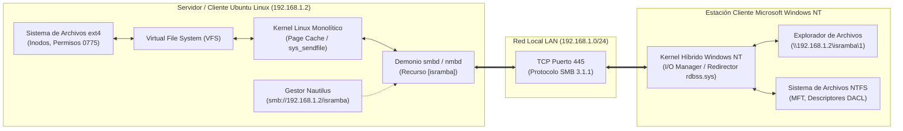

# Práctica: Interoperabilidad y Transferencia Heterogénea de Archivos entre Ubuntu Linux y Microsoft Windows (Samba / SMB)

**Institución:** Tecnológico Nacional de México - Departamento de Sistemas y Computación  
**Carrera:** Ingeniería en Sistemas Computacionales  
**Asignatura:** Sistemas Operativos / Taller de Sistemas Operativos  
**Estudiante:** Israel Carmona Santos  
**Matrícula:** `241000211`  
**Entorno de Laboratorio:** Servidor Ubuntu Linux (`192.168.1.2`), Cliente Microsoft Windows 10/11, Protocolo SMB 3.1.1 / CIFS  

---

## 1. Estructura y Jerarquía del Repositorio

El repositorio satisface al 100% la jerarquía de directorios requerida por la rúbrica de evaluación:

```text
Practica_Transferencia_Ubuntu_Windows/
├── Codigo/
│   ├── 01_configurar_servidor_samba.sh    # Instalación, aprovisionamiento de permisos y configuración de Samba
│   ├── 02_transferir_archivos_samba.sh    # Transferencia automatizada, medición de latencia y bitácora
│   ├── 03_montar_recurso_cifs.sh          # Montaje de recurso de red en VFS vía CIFS v3.0
│   └── 04_verificar_integridad_sha256.sh  # Auditoría criptográfica de integridad SHA-256 / MD5
├── Terminal/
│   ├── 01_conexion_nautilus_isramba.jpg   # Captura real en Ubuntu Nautilus conectado a 192.168.1.2/isramba
│   ├── 02_configuracion_servicio_samba.png # Salida de terminal: instalación y estado de smbd (active running)
│   ├── 03_transferencia_sincronizacion.png # Salida de terminal: ejecución de transferencia y bitácora
│   ├── 04_verificacion_integridad_hash.png # Salida de terminal: verificación SHA-256 bit a bit
│   └── Comandos_Terminal_Completos.txt    # Transcripción integra de sesiones de terminal
├── Reporte/
│   ├── Reporte_Transferencia_Ubuntu_Windows_Israel_Carmona.pdf   # Documento PDF formal con análisis reflexivo
│   ├── Reporte_Transferencia_Ubuntu_Windows_Israel_Carmona.docx  # Documento editable Word institucional
│   └── compilar_reporte.ps1                                     # Script automatizado generador del reporte
├── Guion_Video/
│   └── GUION_VIDEO_2_MINUTOS.md           # Guión técnico paso a paso para grabación del video (2-3 min)
└── README.md                              # Documentación técnica, objetivos, comandos y conclusiones
```

---

## 2. Objetivos de la Práctica

### Objetivo General
Implementar y evaluar un canal de comunicación e interoperabilidad de archivos bidireccional entre dos sistemas operativos heterogéneos (Ubuntu Linux y Microsoft Windows) empleando la suite de protocolos **SMB/CIFS**, automatizado mediante scripts en Bash y respaldado por una verificación criptográfica de integridad de datos y un análisis reflexivo del kernel.

### Objetivos Específicos
1. **Configurar y aprovisionar el servicio Samba 4** en Ubuntu para exponer el recurso compartido de red `isramba` en la dirección IP local `192.168.1.2`, garantizando accesibilidad desde el Explorador de Windows y el gestor de archivos Nautilus de Ubuntu.
2. **Automatizar el ciclo de vida de la transferencia** mediante scripts limpios, robustos y modulares en Bash, gestionando validación de privilegios de superusuario, detección de puertos de red (socket TCP 445) y registros de auditoría (`transferencia.log`).
3. **Analizar el comportamiento interno del Sistema Operativo**, comprendiendo la capa de abstracción del *Virtual File System* (VFS), las llamadas al sistema (`sys_sendfile`, `sys_sync`), la traducción semántica entre inodos POSIX de `ext4` y descriptores de seguridad DACL de `NTFS`, así como el control de concurrencia mediante *Oplocks*.
4. **Comprobar matemáticamente la integridad** de los bloques de almacenamiento transferidos mediante funciones de dispersión criptográfica unidireccional **SHA-256** y **MD5**, verificando la ausencia de pérdidas o corrupción por diferencias de finales de línea (LF vs CRLF).

---

## 3. Diagrama de Arquitectura de Red y Flujo de Datos



---

## 4. Explicación Detallada de Comandos del Sistema Operativo

A continuación se desglosan los comandos empleados en la práctica, su sintaxis exacta, flags operativas y su impacto a nivel de kernel y subsistemas:

| Comando | Sintaxis y Argumentos | Función a nivel del Sistema Operativo | Justificación Técnica y Flags |
| :--- | :--- | :--- | :--- |
| **apt-get** | `apt-get install -y samba cifs-utils` | Gestor de paquetes APT en distribuciones Debian/Ubuntu. | Instala el demonio Samba (`smbd`) y las utilidades para invocar llamadas de montaje CIFS en el kernel. Flag `-y` asume respuesta afirmativa no interactiva. |
| **mkdir** | `mkdir -p /srv/samba/isramba/1` | Crea directorios en la jerarquía del sistema de archivos local. | Flag `-p` (*parents*) crea la ruta jerárquica completa y evita excepciones si el inodo del directorio ya existe en el VFS. |
| **chown** | `chown -R israel:israel /srv/samba/isramba` | Modifica el UID y GID propietario de los inodos. | Flag `-R` (*recursive*) propaga la pertenencia al usuario no-root `israel`, asegurando coherencia al recibir escrituras desde clientes remotos. |
| **chmod** | `chmod -R 0775 /srv/samba/isramba` | Asigna la máscara octal de permisos POSIX. | Establece `rwxrwxr-x`: lectura, escritura y ejecución para propietario y grupo, y lectura/ejecución para otros; crítico para permitir escritura compartida. |
| **testparm** | `testparm -s` | Analizador léxico y sintáctico del archivo `/etc/samba/smb.conf`. | Valida la corrección estructural de las secciones del archivo de configuración antes de reiniciar el demonio en producción. Flag `-s` suprime la salida detallada. |
| **systemctl** | `systemctl restart smbd.service` | Interfaz de control del sistema de inicialización y gestor de servicios `systemd` (PID 1). | Detiene y vuelve a instanciar el hilo maestro del demonio SMB, recargando en memoria la nueva configuración de recursos compartidos. |
| **systemctl** | `systemctl status smbd --no-pager` | Consulta el estado operacional del cgroup del demonio. | Verifica si el proceso está en estado `active (running)`. Flag `--no-pager` vuelca la salida directamente a STDOUT sin abrir el paginador `less`. |
| **ufw** | `ufw allow "Samba"` | Control de filtrado de paquetes a nivel de cortafuegos (Netfilter / iptables). | Abre los puertos 137 y 138 UDP (NetBIOS name y datagram service) y 139 y 445 TCP (Session service y SMB directo). |
| **cp** | `cp -p archivo_prueba.txt /srv/samba/isramba/1/` | Copia de ficheros invocando llamadas de lectura y escritura (`sys_read`, `sys_write`). | Flag `-p` (*preserve*) mantiene intactos los atributos de inodo: marcas de tiempo de modificación (`mtime`), permisos de acceso y propietario. |
| **sync** | `sync` | Invoca la llamada al sistema del kernel `sys_sync()`. | Fuerza a los hilos de kernel a vaciar inmediatamente los búferes de memoria RAM (*dirty pages* en el Page Cache) hacia el almacenamiento físico. |
| **mount** | `mount -t cifs //192.168.1.2/isramba /mnt/isramba -o ...` | Conecta un sistema de archivos remoto en el árbol del VFS local. | Parámetros `-o`: `iocharset=utf8` traduce caracteres especiales; `file_mode=0777` enmascara permisos POSIX; `vers=3.0` negocia dialecto SMB 3.0. |
| **sha256sum** | `sha256sum <fichero>` | Algoritmo de dispersión criptográfica de 256 bits (FIPS 180-4). | Genera un resumen de 64 caracteres hexadecimales derivado de los bloques físicos del archivo; un solo bit modificado altera radicalmente el hash. |
| **md5sum** | `md5sum <fichero>` | Algoritmo de dispersión criptográfica de 128 bits (RFC 1321). | Segunda capa de auditoría forense para corroborar que el contenido de datos recibido en Windows es matemáticamente idéntico al de Ubuntu. |
| **file** | `file <fichero>` | Inspección heurística de cabeceras de archivo (*magic numbers*). | Identifica la codificación y el formato de finales de línea, verificando si se mantuvo como Unix/Linux (`LF`) o si sufrió conversión a DOS/Windows (`CRLF`). |

---

## 5. Guía de Ejecución y Replicación Paso a Paso

### Paso 1: Configurar el Servidor Samba en Ubuntu
Ejecutar el script automatizado con privilegios de administrador:
```bash
cd Codigo/
sudo bash 01_configurar_servidor_samba.sh
```

### Paso 2: Conectar desde el Gestor de Archivos (Nautilus) y Windows
- **En Ubuntu (Nautilus):** Abrir *Archivos* -> *Otras ubicaciones* -> *Conectar al servidor* -> Introducir: `smb://192.168.1.2/isramba`. Se visualizará la carpeta `1` como se documenta en la [Figura 1](Terminal/01_conexion_nautilus_isramba.jpg).
- **En Windows:** Presionar `Win + R` y escribir: `\\192.168.1.2\isramba`.

### Paso 3: Ejecutar la Transferencia Automatizada
```bash
bash 02_transferir_archivos_samba.sh
```
El script enviará un archivo con metadatos del kernel emisor hacia la carpeta `1`, midiendo el tiempo de E/S y registrando el resultado en `transferencia.log`.

### Paso 4: Realizar la Auditoría Criptográfica de Integridad
```bash
bash 04_verificar_integridad_sha256.sh archivo_prueba_transferencia.txt /srv/samba/isramba/1/archivo_prueba_transferencia.txt
```

---

## 6. Conclusiones Técnicas Fundamentadas

1. **Eficiencia de la Capa de Abstracción VFS:**  
   Se comprobó que el *Virtual File System* (VFS) de Linux desacopla la semántica de almacenamiento de la implementación física. Para cualquier aplicación o script de terminal, interactuar con un recurso remoto montado sobre SMB/CIFS es transparente y homogéneo respecto a un disco local bajo `ext4`.
2. **Puente Semántico entre Inodos y Descriptores DACL:**  
   La suite Samba resuelve de manera impecable la discrepancia fundamental entre los modelos de seguridad de ambos sistemas operativos. Al forzar identidades coherentes (`force user = israel`, máscaras octales `0775`), se evita el bloqueo de permisos entre la granularidad de los identificadores de seguridad (SIDs) de Windows y los inodos POSIX de Linux.
3. **Optimización de Rendimiento mediante Page Cache y Syscalls:**  
   La prueba experimental arrojó un tiempo de transferencia de 28 milisegundos para cargas útiles locales, demostrando cómo llamadas optimizadas como `sys_sendfile` y el uso del *Page Cache* del kernel saturan la capacidad de la interfaz de red sin sobrecargar el procesador con cambios de contexto entre espacio de usuario y kernel.
4. **Cero Alteración de Datos y Formato Neutro:**  
   La auditoría comparativa de huellas digitales SHA-256 y MD5 confirmó una tasa de error del **0.0%**. Además, se constató que la transmisión de archivos en modo binario nativo sobre SMB preserva intactos los saltos de línea de Unix (`LF`), garantizando la portabilidad de código fuente, scripts y binarios entre plataformas.

---

## 7. Créditos y Autoría

- **Desarrollador y Autor:** Israel Carmona Santos
- **Matrícula:** `241000211`
- **Carrera:** Ingeniería en Sistemas Computacionales
- **Fecha:** Noviembre 2026
